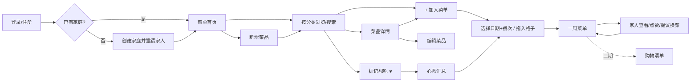

# 家用电子菜单网站 — 信息架构与关键流程（设计稿 v0.1）

> 状态：设计提案，尚未实现。核心体验：像翻纸质餐厅菜单一样浏览菜品，全家一起挑菜、排进「一周菜单」。

## 1. 信息架构（页面清单 + 层级）

```
家用电子菜单
├── 0. 登录 / 注册 / 加入家庭（邀请码或链接）
├── 1. 菜单（首页，默认进入）
│   ├── 分类导航（热菜 / 凉菜 / 汤羹 / 主食 / 甜点 / 自定义分类）
│   ├── 菜品卡片网格（照片、菜名、标签、"想吃"标记、+加入菜单）
│   ├── 搜索 / 筛选（食材、口味、耗时、谁想吃）
│   └── 一周菜单侧栏（宽屏常驻，手机为底部抽屉）
├── 2. 菜品详情（大图、简介、食材、做法、谁想吃、历史上过哪几天）
│   └── 2a. 新增 / 编辑菜品（照片上传、名称、分类、标签、食材、做法）
├── 3. 一周菜单（完整视图）
│   ├── 周一~周日 × 早/午/晚（餐次可配置）
│   ├── 切换周（上周 / 本周 / 下周）、复制上周
│   └── 衍生：购物清单（按食材汇总，可选，二期）
├── 4. 家人心愿（"想吃"汇总 / 投票排行）
└── 5. 我的 / 家庭设置
    ├── 个人资料（头像、昵称、忌口）
    ├── 家庭成员管理（邀请、移除、角色：管理员/成员）
    └── 分类管理、餐次设置
```

导航：桌面端左侧分类 + 顶部（菜单 / 一周菜单 / 心愿 / 我的）；手机端底部 Tab 4 个：菜单、一周、心愿、我的。

## 2. 关键用户流程

**A. 浏览菜单 → 挑菜 → 排进一周菜单（主流程）**
1. 进入首页「菜单」，按分类翻页/滚动浏览（桌面可用翻页动效，手机左右滑分类）。
2. 点卡片看详情，或直接点「+ 加入菜单」。
3. 弹出轻量选择器：选日期（默认今天/下一个空位）+ 餐次 → 确认。
4. 桌面：也可把卡片直接拖进右侧一周菜单格子。
5. 一周菜单实时更新，家人可见；可调整、删除、拖动换天。

**B. 家人协作：标记想吃 / 投票**
1. 任一成员在卡片上点「想吃 ♥」，卡片显示想吃人头像。
2. 「心愿」页按想吃人数排序；管理员（掌勺人）一键排入某天。
3. 一周菜单中每道菜显示是谁点的；成员可对已排菜点 👍/换一道（提议）。
4. 新变更给其他成员小红点提示（实时同步或刷新后可见，待定）。

**C. 新增 / 编辑菜品**
1. 菜单页「+ 新菜品」或详情页「编辑」。
2. 上传/拍照 → 自动裁成 4:3 预览；填菜名（必填）、分类（必填）、标签、食材、做法（选填）。
3. 保存后出现在对应分类；可设"仅自己可见/全家可见"（待定）。

**D. 登录 / 家庭成员管理**
1. 首位用户注册 → 创建家庭（命名"我家"）→ 获得邀请链接/码。
2. 家人通过链接注册并加入；每人独立账号与头像。
3. 管理员可移除成员、转让管理员；成员可退出家庭。

## 3. 主流程图



## 4. 响应式要点
- 手机（<768）：单列/双列卡片，底部 Tab，一周菜单为可上拉的底部抽屉；左右滑切换分类，长按卡片快速加入。
- 常规桌面（1280–1920）：左分类 + 3–4 列网格 + 右侧可折叠一周菜单栏。
- 带鱼屏（≥2560 且宽高比 ≥ 21:9）：「摊开的菜单书」跨页布局——左页菜品网格 5–6 列，右页一周菜单常驻并展开 7 天×餐次；内容最大宽度受控，避免卡片被无限拉宽。

## 5. 待产品经理确认的问题
1. 餐次范围：只排午/晚餐，还是含早餐/加餐？是否可按家庭自定义？
2. 决策权：谁能最终排菜——所有成员平等，还是"掌勺人/管理员"拍板、其他人只提议？
3. 投票机制：简单"想吃"标记即可，还是需要每周限票/排行？
4. 菜品来源：只靠家人手动录入，还是需要预置常见家常菜库（含图片版权问题）？
5. 是否需要购物清单 / 食材汇总？放首版还是二期？
6. 协作实时性：需要实时同步（WebSocket）还是刷新可见即可？是否需要通知？
7. 一个用户能否属于多个家庭（如父母家 + 自己家）？
8. 是否支持儿童账号（无邮箱/手机号、简化界面）？
9. 登录方式：手机号验证码、邮箱、微信？
10. 历史菜单是否保留并支持"复制上周"/"最近吃过"提醒（避免重复）？
11. 是否需要忌口/过敏标签与提醒？
12. 带鱼屏是否同时考虑厨房平板/电视展示模式（只读大屏）？
